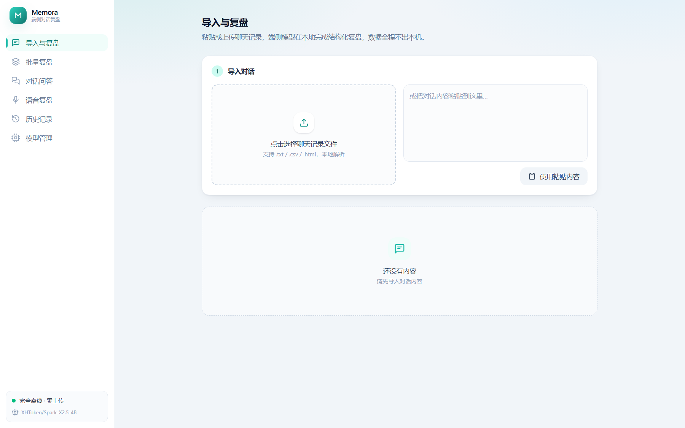
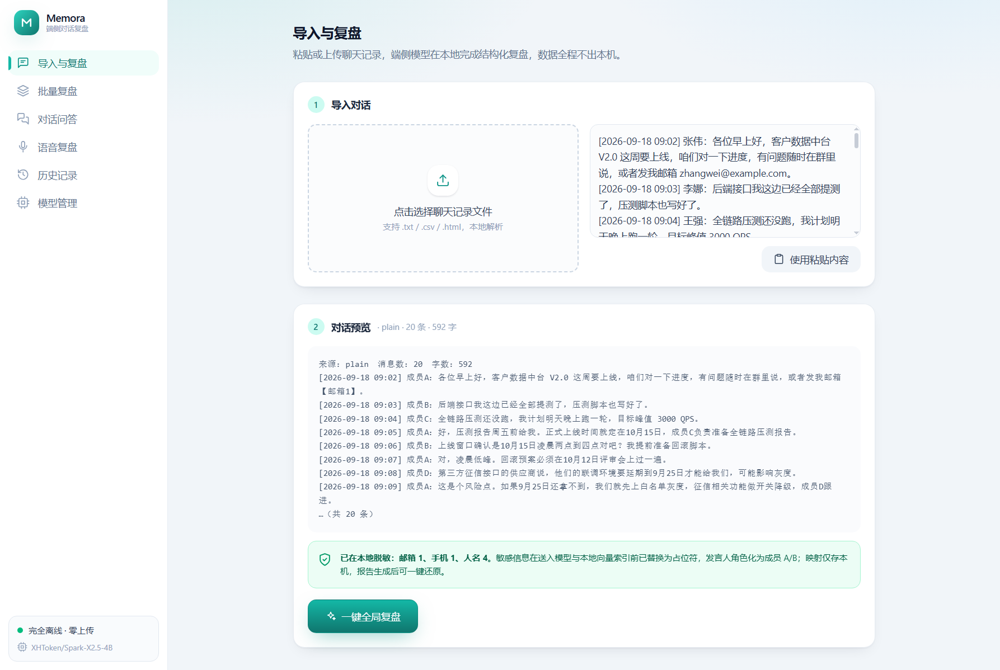
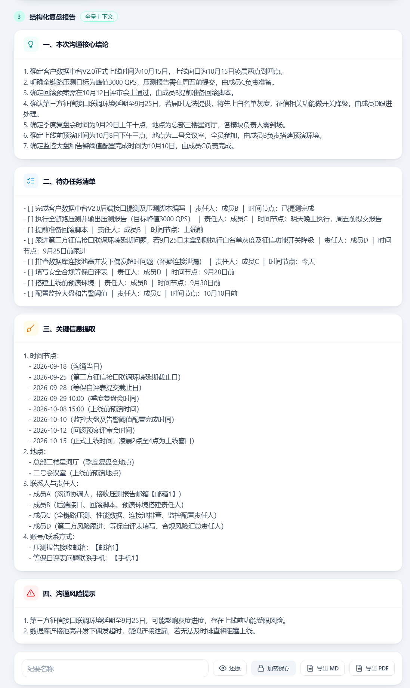
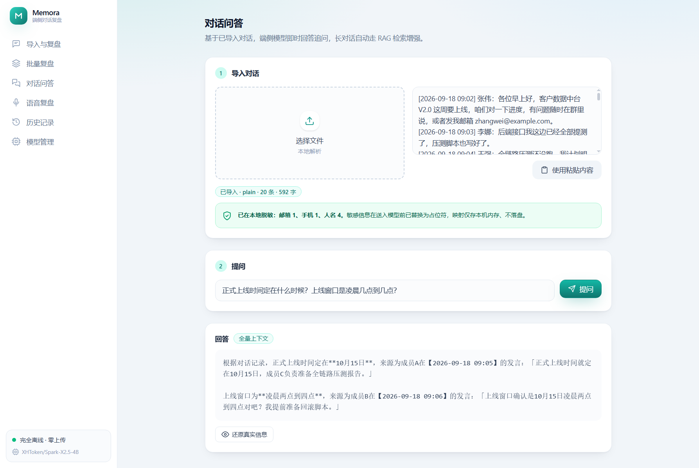
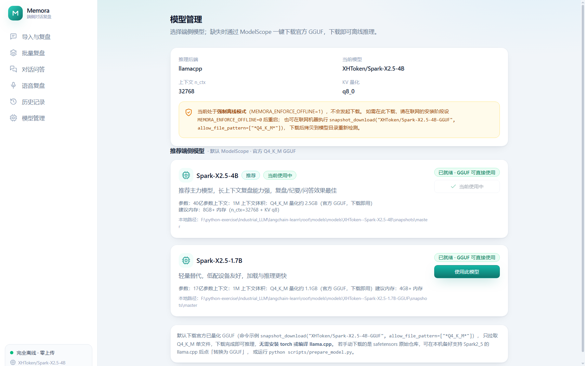
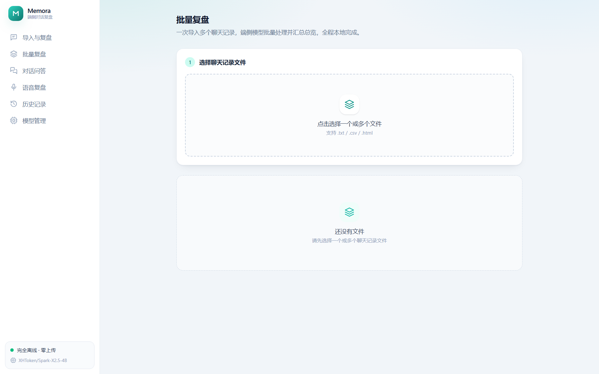
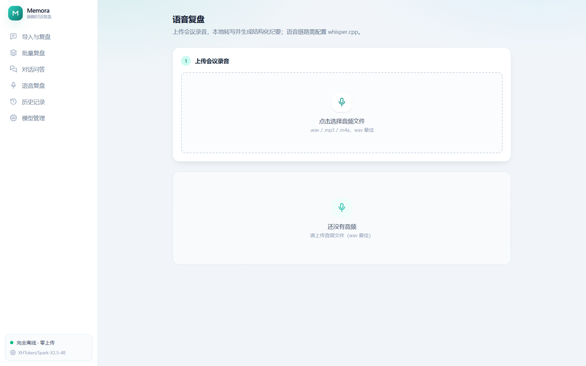
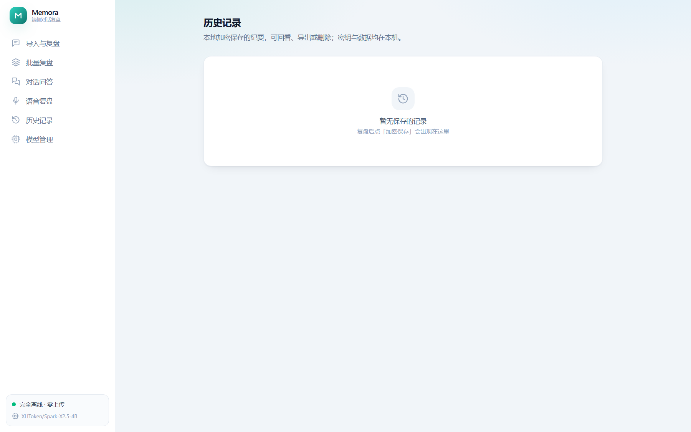

<div align="center">

<h1>🧠 Memora</h1>

<p><strong>On-device, Offline-first &amp; Privacy-preserving Conversation Review</strong></p>

<p>


</p>

<p>Spark-X2.5 on-device LLM ・ llama.cpp ・ local bge-m3 + FAISS ・ FastAPI + Next.js</p>

<p>
<strong>English</strong>
&nbsp;|&nbsp;
<a href="README.md">简体中文</a>
</p>

</div>

---

> A **fully offline, privacy-first** tool that turns long work-group chats into structured meeting minutes.
> It packs the **Spark-X2.5 on-device small model + local Retrieval-Augmented Generation (RAG)** onto an ordinary
> **8GB-RAM Windows PC**. **Your data never leaves the machine** — yet hundreds or thousands of messages are distilled
> into **Key Decisions / Action Items / Risks**, with follow-up Q&amp;A grounded in the full conversation.
>
> **No GPU, no torch, no network required** — a single local folder that replaces cloud meeting-minutes SaaS
> (which force you to upload sensitive chats).

---

## ✨ Why Memora

Cloud minute-taking is powerful, but industrial chats contain **customer data, release windows, incident details and
owners** that should not be uploaded. Meanwhile, on-device 1.7B/4B models struggle with context length, lost-in-the-middle
and unstable structure. Memora solves this with an all-local, measurable and reproducible pipeline:

- 🔒 **Truly offline & private**: `MEMORA_ENFORCE_OFFLINE=1` by default — the app **never reaches the network**, even when
  a model is missing; inference binds only to `127.0.0.1`. Phone / ID / bank card / email / license plate / passport /
  person names are **redacted on-device before reaching the model**; the mapping lives only in memory and can be restored
  with one click, while stored records are Fernet-encrypted.
- 📚 **Long conversations without losing context (local RAG)**: short chats are fed **whole, with zero loss**; long chats are
  chunked and retrieved with on-device **bge-m3 embeddings + FAISS** (multi-way semantic recall + timeline skeleton), guarded
  by a **hard context budget** so the model window is never exceeded — instead of naively dropping the oldest messages.
  Pure CPU, no torch.
- 🧾 **Structured review & grounded Q&amp;A**: a fixed four-section report (Decisions / Action Items / Risks / Key Information),
  with meeting **time / venue / arrangements deterministically re-homed** into the decisions section. Q&amp;A retrieves over the
  whole conversation, answers carry **verbatim citations**, and unmentioned questions are explicitly answered as "not discussed".
- 💬 **Real multi-platform parsing**: WeChat (txt, including GBK), DingTalk (csv) and Feishu/Lark (html) exports, with automatic
  encoding/format detection and 10 real parsing samples.
- ⚡ **Product-grade experience**: **token-by-token SSE streaming**, a Next.js SPA, single-origin deployment on one port
  (end users need **no Node.js**), Markdown/PDF export and batch review.
- 🧩 **One-click model management**: the home and model pages explicitly recommend **Spark-X2.5-4B / 1.7B**, detect whether the
  model exists locally, and — after a confirmation dialog — download the official Q4_K_M GGUF automatically via
  **ModelScope `snapshot_download`**, ready to use with no manual conversion.

## 📊 Evaluation & Ablation (measured, not claimed)

A built-in benchmark of 50 synthetic conversations (30 short + 20 long) with 346 probing Q&amp;A pairs. Greedy decoding
(`MEMORA_TEMP=0`) makes results reproducible. Metrics cover **recall & precision for action items / risks / decisions,
risk extraction completeness, Q&amp;A evidence hit rate and hallucination rate**, exported as a single-file HTML report.

**Main leaderboard (Spark-X2.5-4B, Q4_K_M)**

| Scenario | Action recall | Risk recall | Decision recall | Risk completeness | QA evidence hit | Hallucination |
|---|---|---|---|---|---|---|
| Short chat · full context (n=30) | 0.928 | 0.967 | **0.900** | 0.983 | 1.000 | **0** |
| Long chat · local RAG (n=20) | 0.900 | 0.942 | **0.908** | 0.958 | 1.000 | **0** |

**Long-context strategy ablation (n=6 per group)**

| Strategy | Action / Risk recall | QA evidence hit | Verdict |
|---|---|---|---|
| 4B full context (exceeds window) | 0.250 / 0.250 | 0.000 | Breaks down, ~639s, unusable |
| 4B rule-based timeline compression | 0.944 / 0.917 | 1.000 | Fallback when no embedding model |
| **4B local RAG (bge-m3 + FAISS)** | **0.900 / 0.942** | **1.000 | **Best recall & usability — the default** |
| 1.7B local RAG (ultra-low-resource) | 0.694 / 0.611 | 0.333 | Runs in 4GB RAM; weaker Q&amp;A |

> Takeaway: local RAG rescues long conversations from the full-context failure (recall 0.25, QA 0) back to
> **0.90+ recall, QA evidence hit 1.0 and zero hallucination**. Full results: `evals/results/final/report.html`.

## 🖥️ Pages

| Page | Route | Description |
|---|---|---|
| Review (home) | `/` | Paste / upload a chat → PII preview → streamed structured report, one-click export |
| Q&amp;A | `/qa/` | Ask questions over the whole conversation; answers cite the original messages |
| Model management | `/models/` | Dual-model recommendation, local status detection, one-click ModelScope download, live switching |
| Batch review | `/batch/` | Process and summarize multiple records in bulk |
| Voice minutes (optional) | `/voice/` | Transcribe locally with whisper.cpp, then review |
| History | `/history/` | Locally encrypted review history |

## 📸 Screenshots

**① Import a chat** — paste or upload a chat export; encoding and platform format are auto-detected.

<p></p>

**② Local parsing & PII redaction** — speakers are role-ized as Member A/B; phone / email / names are replaced with placeholders before reaching the model. The mapping stays on-device and is restorable with one click.

<p></p>

**③ Structured review report** — four sections: Key Decisions / Action Items (with owner & due date) / Key Information / Risks, with meeting decisions deterministically re-homed.

<p></p>

**④ Grounded Q&A** — retrieval-augmented over the whole conversation; answers carry verbatim citations, and unmentioned topics are explicitly reported as "not discussed".

<p></p>

**⑤ Model management / Batch review / Voice minutes / History**

<table>
<tr>
<td align="center"></td>
<td align="center"></td>
</tr>
<tr>
<td align="center"></td>
<td align="center"></td>
</tr>
</table>

## 🚀 Quick Start

**Requirements**: Windows 10/11 (64-bit), Python 3.10–3.12 (3.12 recommended); ~8GB RAM for the 4B model (~4GB for 1.7B);
~3GB disk. Node.js 18+ is only needed if you modify the frontend, not for normal use.

```bash
# 1) Get the code and install dependencies (no torch, no compilation on the default path)
git clone https://gitee.com/FreeBlank/memora.git
cd Memora
python -m venv .venv && .venv\Scripts\activate
pip install -r requirements.txt

# 2) Environment doctor: checks dependencies / engine / models / disk and suggests fixes
python scripts/doctor.py

# 3) One-click start (doctor -> backend; single-port direct access when the static build exists)
scripts\start.bat
#   Then open http://127.0.0.1:8000
```

**Prepare the inference engine (llama.cpp)**: download a Windows CPU build from the
[llama.cpp official releases](https://github.com/ggml-org/llama.cpp/releases) **dated after 2026-09-07 that includes the
Spark2_5 architecture** (e.g. `llama-b11046-bin-win-cpu-x64.zip`), and extract it into `tools/llamacpp/bin/`;
or set `MEMORA_LLAMASERVER_PATH` to your `llama-server.exe`.

**Prepare the models (network needed during setup)** — either:

- UI: open **Model management**, click **Download** on a recommended card and confirm; the official Q4_K_M GGUF is fetched
  automatically from ModelScope; or
- CLI (first run `set MEMORA_ENFORCE_OFFLINE=0` during setup):

```bash
python scripts/prepare_model.py                                  # default 4B
python scripts/prepare_model.py --model XHToken/Spark-X2.5-1.7B  # lighter 1.7B
```

Equivalent official ModelScope commands (only the single Q4_K_M file is pulled):

```python
from modelscope import snapshot_download
snapshot_download('XHToken/Spark-X2.5-4B-GGUF',   allow_file_pattern=['*Q4_K_M*'])  # ~2.5GB, 8GB+ RAM
snapshot_download('XHToken/Spark-X2.5-1.7B-GGUF', allow_file_pattern=['*Q4_K_M*'])  # ~1.1GB, 4GB+ RAM
snapshot_download('gpustack/bge-m3-GGUF',         allow_file_pattern=['*Q4_K_M*'])  # local RAG embeddings, ~438MB
```

> **Offline guard**: `MEMORA_ENFORCE_OFFLINE=1` by default — the app never goes online; a missing model only raises an error
> with the exact command. Keep the default for an offline demo. You can also download on a connected machine and copy the
> `root/models/models/XHToken--Spark-X2.5-*-GGUF` folder to the same relative location on the target machine.

## 📦 Fully Offline Deployment (to an air-gapped machine)

Run once on a **connected** packaging machine with the same architecture (64-bit Windows + Python 3.10–3.12):

```powershell
# Builds the app + static frontend + local wheelhouse (~70+ wheels incl. binary faiss/numpy)
powershell -ExecutionPolicy Bypass -File scripts/build_offline.ps1
# Add -IncludeModels to also bundle the models (~4GB)
```

The output is `release/Memora/`. Copy the whole folder to a **fully disconnected** Windows machine, then:

```bat
install_offline.bat   :: install dependencies purely offline from the local wheelhouse (pip --no-index)
start.bat             :: start and open http://127.0.0.1:8000
```

**Air-gap acceptance checklist**: `python scripts/doctor.py` all green → physically unplug the network → complete one long-chat
review and one Q&amp;A. The repo ships `scripts/e2e_offline_check.py` (24 end-to-end checks: static hosting, PII redaction &
restoration, SSE streaming, automatic short/long context switching, and zero outbound connections during inference).

## 🏗️ Architecture

The backend is a thin FastAPI layer; all business logic lives in `memora/`. On first inference the default backend launches a
local `llama-server` on a random port (bound to 127.0.0.1 only), speaks the OpenAI-compatible protocol, and terminates the
subprocess on exit / model switch.

```text
Chat export (txt/csv/html)
        │  encoding detection · multi-platform parsing (WeChat/DingTalk/Feishu)
        ▼
   On-device PII redaction (mapping in memory only; restorable)
        │
        ├── short chat ──► full context, zero loss
        └── long chat ───► bge-m3 embeddings + FAISS multi-way recall + timeline skeleton (hard context budget)
        ▼
  llama-server · Spark-X2.5 GGUF (OpenAI-compatible, pure CPU / optional GPU)
        ▼
 Structured report (Decisions/Action items/Risks/Key info + meeting-decision re-homing)
        │            └─ SSE token streaming ─► Next.js frontend
        │               Q&A: same retrieval context + verbatim citations
        ▼
 Fernet-encrypted storage (data/vault) · Markdown / PDF export
```

**Project layout**

```text
Memora/
├── memora/                 # Core business logic (reused by FastAPI)
│   ├── parsers/            #   WeChat / DingTalk / Feishu parsers + encoding detection
│   ├── pii/                #   PII redaction & restoration
│   ├── retrieval/          #   bge-m3 + FAISS local RAG, context budget & timeline skeleton
│   ├── agent/              #   LangChain review / Q&A / voice chains, streaming
│   ├── report/             #   report structuring & meeting-decision re-homing (single source of truth for eval & product)
│   ├── prompts/            #   prompt templates
│   ├── backend/            #   llama-server subprocess backend + optional SGLang backend
│   ├── storage/            #   Fernet local encryption
│   ├── whisper/            #   local transcription (optional)
│   ├── model_fetch.py      # model acquisition state machine (official GGUF download + safetensors conversion fallback)
│   ├── exporter.py         # Markdown / PDF export
│   └── batch.py            # batch review
├── server/                 # FastAPI: single port 8000, same-origin hosting of web/out
│   └── routes/             #   review / qa / models / records / export / voice / health
├── web/                    # Next.js + React + Tailwind (app pages + out static build)
├── evals/                  # benchmark, metrics, worker/runner, single-file HTML report
├── samples/                # real WeChat/DingTalk/Feishu parsing samples
├── scripts/                # doctor / prepare_model / start.bat / build_offline.ps1 / e2e
├── tests/                  # 125 pytest cases (no model loading, no network)
├── tools/llamacpp/bin/     # official llama.cpp binaries (download yourself; not in git)
├── requirements.txt        # full dependencies (dev / packaging)
└── requirements-runtime.txt# runtime dependencies (for offline install)
```

## ⚙️ Configuration (`.env` / environment variables)

Copy `.env.example` to `.env` and adjust as needed; every key can be overridden by a same-named environment variable.

| Key | Default | Description |
|---|---|---|
| `MEMORA_MODELS_ROOT` | `../root/models` | Model root (ModelScope cache dir) |
| `MEMORA_MODEL_ID` | 4B | Active model (usually written to `data/settings.json` by the model page) |
| `MEMORA_BACKEND` | `llamacpp` | `llamacpp` (local subprocess) / `sglang` (external GPU server) |
| `MEMORA_ENFORCE_OFFLINE` | `1` | Offline guard: 1 = block all downloads, only raise on a missing model |
| `MEMORA_N_CTX` / `MEMORA_KV_QUANT` | `32768` / `q8_0` | Context window / KV quantization (~3.5GB, 8GB-friendly) |
| `MEMORA_N_GPU` | `0` | GPU offload layers; 0 = all CPU, -1 = all on GPU |
| `MEMORA_RAG_ENABLE` | `1` | Long-chat local RAG; auto-falls back to rule compression without an embedding model |
| `MEMORA_PII_REDACT` | `1` | PII redaction toggle (including speaker name role-ization) |
| `MEMORA_TEMP` / `MEMORA_MAX_REVIEW` / `MEMORA_MAX_QA` | `0.3` / `4096` / `1024` | Decoding temperature & max generation length |

## 🧪 Tests & Reproducing the Evaluation

```bash
python -m pytest tests/ -q                          # 125 unit tests: no model loading, no network
# Real-machine offline end-to-end (models required, 24 checks)
set MEMORA_ENFORCE_OFFLINE=1 && python scripts/e2e_offline_check.py
# Full benchmark & ablation (models required, long-running; greedy & reproducible, resumable)
cd evals && python runner.py
```

## 🗺️ Roadmap

- [x] Multi-platform parsing, PII redaction, local RAG, SSE streaming, one-click model download, offline package, evaluation & ablation
- [ ] Ship the whisper.cpp / ffmpeg voice pipeline in the package (currently an optional experiment)
- [ ] PyInstaller / WebView desktop EXE installer
- [ ] Parsers for more IM / meeting-platform exports
- [ ] Configuration-matrix benchmarks (8GB/16GB, Intel/AMD, with/without GPU)

## 🙏 Acknowledgements & Third-Party Notices

Memora stands on the shoulders of open source. The **copyright of the following third-party open-source components, models
and data always remains with their respective authors / rights holders**. Memora only uses them as dependencies or points you
to their downloads; it **does not claim, transfer or redistribute** any of their rights, and you must keep complying with
their licenses.

**Open-source software dependencies**

| Component | Used for | License |
|---|---|---|
| [llama.cpp](https://github.com/ggml-org/llama.cpp) | On-device GGUF inference engine (llama-server) | MIT |
| [LangChain](https://github.com/langchain-ai/langchain) / langchain-core / langchain-openai | Agent & chain orchestration | MIT |
| [FastAPI](https://github.com/fastapi/fastapi) / [Uvicorn](https://github.com/encode/uvicorn) | Backend HTTP / ASGI | MIT / BSD-3-Clause |
| [faiss-cpu](https://github.com/facebookresearch/faiss) / [NumPy](https://numpy.org) | Local vector retrieval / numerics | MIT / BSD-3-Clause |
| [pandas](https://pandas.pydata.org) / [Beautiful Soup](https://www.crummy.com/software/BeautifulSoup/) | Parsing helpers | BSD-3-Clause / MIT |
| [chardet](https://github.com/chardet/chardet) | Encoding detection (dynamically linked as a library, unmodified) | LGPL-2.1-or-later |
| [ModelScope SDK](https://github.com/modelscope/modelscope) | One-click model download | Apache-2.0 |
| [cryptography](https://github.com/pyca/cryptography) | Fernet local encryption | Apache-2.0 OR BSD-3-Clause |
| [python-multipart](https://github.com/Kludex/python-multipart) / [python-dotenv](https://github.com/theskumar/python-dotenv) / [reportlab](https://www.reportlab.com) | Forms / config / PDF export | Apache-2.0 / BSD-3-Clause / BSD-3-Clause |
| [Next.js](https://nextjs.org) / [React](https://react.dev) / [Tailwind CSS](https://tailwindcss.com) | Frontend framework & styling | MIT |
| [pytest](https://github.com/pytest-dev/pytest) | Testing framework | MIT |

**Models & data (not distributed in this repository)**

| Resource | Rights holder / source | License |
|---|---|---|
| Spark-X2.5-4B / 1.7B (incl. GGUF conversions) | XHToken ([ModelScope](https://modelscope.cn/models/XHToken/Spark-X2.5-4B-GGUF)) | As stated on the official model page |
| bge-m3 (GGUF) | BAAI / gpustack ([ModelScope](https://modelscope.cn/models/gpustack/bge-m3-GGUF)) | As stated on the official model page |

> This repository **does not bundle or redistribute** the model weights or llama.cpp binaries; you must obtain them from
> their official sources. License information is subject to each project's official `LICENSE`. If you redistribute Memora,
> you are responsible for simultaneously satisfying the licenses of the referenced components and models.

## 📄 License

The **original source code and documentation** of Memora are released under the permissive [MIT License](LICENSE): you may
freely use, modify, merge, publish, distribute and even use them commercially, provided the copyright and permission notices
are retained in all copies; the software is provided "as is" without any warranty.

- The MIT License **covers only the original code and documentation written by the Memora authors**; it **does not alter or
  override** the licenses of any third-party component or model listed above.
- It is business-friendly and **compatible** with common open-source licenses such as MIT / BSD / Apache / LGPL (dynamic
  linking), so it does not infringe the rights of the referenced open-source projects.
- For any questions about commercial use of the model weights, please refer to the official terms of Spark-X2.5 and bge-m3.
